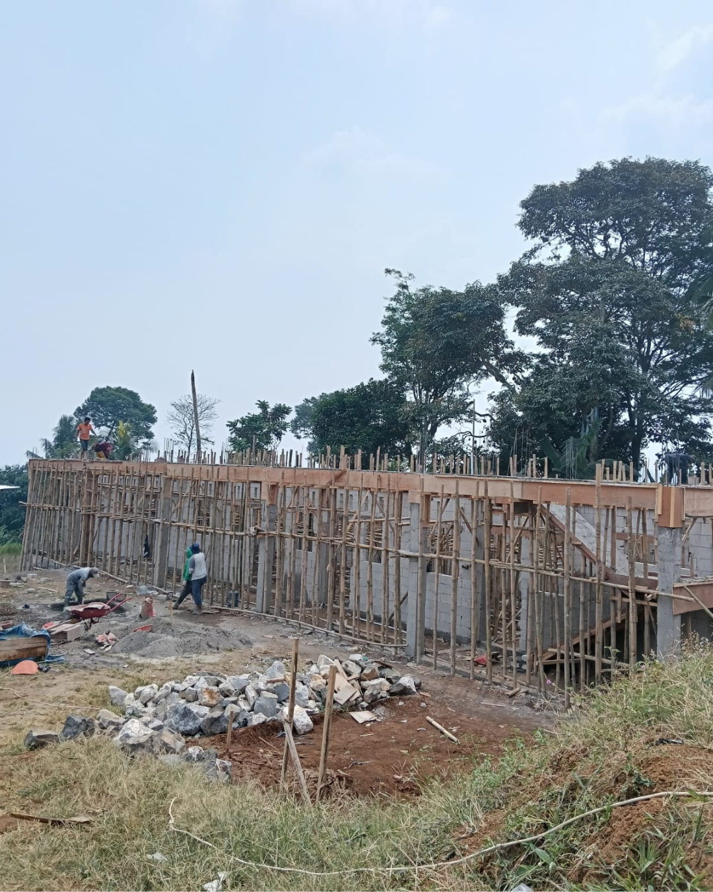

Yayasan Mawaddah Indonesia kini sedang membangun pesantren baru, **Taisiru Ar-Rahman Boarding School (TABS) Gadog** di Bogor, Jawa Barat.

Pembangunan gedung terus berjalan: dinding dan kerangka bangunan sudah berdiri, dan pekerjaan dilanjutkan secara bertahap.

Kami mengajak kaum muslimin turut mendoakan kelancaran pembangunan dan mendukungnya melalui program [Wakaf Pondok Pesantren](/wakaf-pesantren/).

Kabar perkembangan selanjutnya akan kami sampaikan di halaman ini.
